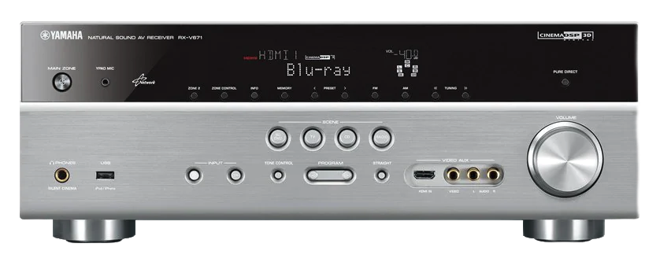

# Viritin

**Your AV receiver has an internet radio button that stopped working. Viritin makes it work again** — the same menus, the same remote, no app and no second box.

Receivers from Yamaha, Denon, Marantz, Onkyo, Pioneer, Harman Kardon and Pro-Ject shipped with internet radio powered by vTuner. That service has since moved behind a subscription, and some manufacturers migrated their customers elsewhere by firmware update — leaving a lot of perfectly good hardware with a dead button. Viritin answers the service the receiver is still trying to reach, so it browses and plays exactly as it always did.

> **Viritin is a maintained fork of [YTuner](https://github.com/coffeegreg/YTuner) by Greg P.** — MIT licensed, and the origin of nearly all of this code. The fork carries fixes and features upstream has not taken, builds with the Free Pascal compiler your distribution ships, and is tested in CI. See [doc/VIRITIN.md](doc/VIRITIN.md) for what changed, why it is named the way it is, and what is planned.



## How it works

The receiver has vTuner's hostname burned into its firmware, so the whole trick is making that name resolve to your machine instead. Viritin then answers the requests the receiver sends, serving the menu structure the firmware already knows how to draw — filled with stations from [Radio Browser](https://www.radio-browser.info) and from your own list.

**Audio does not normally pass through Viritin at all.** It hands the receiver a stream URL and the receiver fetches it directly, which is why the service stays small and why its location barely matters.

## Features

**Stations**
* Thousands of stations from [Radio Browser](https://www.radio-browser.info), with per-receiver filtering and sorting, and a menu translator for non-English users.
* Your own station list, as an `.ini` file or a YCast-compatible `.yaml`.
* Bookmarks saved with the receiver's own remote — shared across receivers, or one file each.
* Station logos converted and resized on the fly (JPEG, PNG, GIF, TIFF), optionally cached.
* Extensive Radio Browser caching: files, memory, or a full local SQLite mirror.

**Added in this fork**
* **A "Local Stations" menu entry** that goes straight to your country, instead of scrolling a few hundred of them with a jog dial.
* **Podcasts** — an RSS feed becomes a folder, each episode a station. [Details below](#podcasts).
* **Playlist resolution** — `.m3u`, `.pls`, `.asx` and `.xspf` unwrapped to the stream inside, for firmware that cannot follow one.
* **An HTTPS relay** — a growing share of stations are HTTPS-only and these receivers have no TLS at all. Off by default; it puts Viritin in the audio path while a station plays.
* **A stations editor in the browser**, so the list is not something you edit over SSH. Off by default, and refuses to start without a password.
* **Curated per-country station presets**, fetched from a central list and merged into your own stations. [Details below](#country-presets).
* **Frontier Silicon table radios** — Hama, Medion, Technisat, Roberts, Pure, Sangean and others, whose vTuner directory died in 2019. [Details below](#frontier-silicon-radios).
* **A Home Assistant add-on** — [below](#quickest-start-the-home-assistant-add-on).
* **Remote hosting from a VPS**, with one setting on the amplifier and no router configuration — [below](#remote-hosting-vps).
* **The bug fixes**, including a crash that ended the process outright and filters that silently did nothing. All listed in [doc/VIRITIN.md](doc/VIRITIN.md).

**Built-in services**
* Web service answering the receiver's requests.
* Optional DNS service, to intercept `*.vtuner.com` lookups.
* Optional maintenance service.

Runs on Linux, macOS, BSD, Solaris, Raspberry Pi OS, OpenWRT and Windows — on i386, AMD64/x86_64, ARM/ARM64, PowerPC or SPARC, and anything else the [Free Pascal Compiler](https://www.freepascal.org/) targets. It is small: serving radio, the process holds about 8 MB resident behind a 4.6 MB binary.

## Quickest start: the Home Assistant add-on

If you run Home Assistant, this is the least work by a distance. Settings → Add-ons → Add-on store → **⋮** → **Repositories**, add:

```
https://github.com/ollisulopuisto/viritin
```

then install **Viritin**. The first install compiles from source, so give it a few minutes — longer on a Raspberry Pi. Options are exposed in the UI and your station files live in the add-on's configuration folder.

[**viritin/DOCS.md**](viritin/DOCS.md) covers every option, both ways of pointing the receiver at it, where your files live, and the port conflicts to watch for on a Home Assistant machine.

## Supported devices
***Theoretically, Retuner should work with most AVRs that support vTuner.***  
The list below was built up by people testing with their own hardware, upstream's contributors included. It grows the same way.

***If you try Viritin with a receiver that is not listed, please open an issue and say how it went.*** 

### Confirmed working

> This list is the devices people have reported, not a survey of what can work.
> [doc/DEVICES.md](doc/DEVICES.md) has what could be established without the
> hardware — which brands vTuner actually provisioned, which are worth trying,
> and how to find out what hostname your device asks for so a report is useful.
- Yamaha
  * Yamaha RX-V671
  * Yamaha RX-V673
  * Yamaha RX-V675 (Tested by [seldam](https://github.com/seldam). Thank you.)
  * Yamaha RX-V677 (Tested by Jordan / [jordandalley](https://github.com/jordandalley). Thank you.)
  * Yamaha RX-V773 (Tested by d1vzero / [d1vzero](https://github.com/d1vzero). Thank you.)
  * Yamaha RX-V777 (Confirmed by Jordan / [jordandalley](https://github.com/jordandalley). Thank you.)
  * Yamaha RX-V473 (Tested by [bbird58138](https://github.com/bbird58138). Thank you.)
  * Yamaha RX-V573 (Tested by [esibilike](https://github.com/esibilike). Thank you.)
  * Yamaha RX-V477 (Tested by [forumgithub010524](https://github.com/forumgithub010524). Thank you.)
  * Yamaha RX-V3900 (Tested by [BeryBurnout](https://github.com/BeryBurnout). Thank you.)
  * Yamaha RX-V500D (Tested by [qsm101](https://github.com/qsm101). Thank you.)
  * Yamaha RX-A730 (Tested by [Sportich](https://github.com/Sportich). Thank you.)
  * Yamaha RX-A810 (Tested by [kauai68](https://github.com/kauai68). Thank you.)
  * Yamaha RX-A820 (Tested by [Prideland](https://github.com/Prideland). Thank you.)
  * Yamaha RX-A3000 (Tested by [sydvicous](https://github.com/sydvicous). Thank you.)
  * Yamaha DSP-Z7 (Tested by Beatrice / [TheBossME](https://github.com/TheBossME). Thank you.)
  * Yamaha NP-S2000  (Tested by [Ice64zzz](https://github.com/Ice64zzz). Thank you.)
  * Yamaha R-N500 (Tested by [kauai68](https://github.com/kauai68). Thank you.)
- Marantz
  * Marantz NR1604 (Tested by [jukonek](https://github.com/jukonek). Thank you.)
  * Marantz NR1607 (Tested by [brietman](https://github.com/brietman). Thank you.)
  * Marantz M-CR510 (Tested by [lionelschiepers](https://github.com/lionelschiepers). Thank you.)
  * Marantz M-CR610 (Tested by [dzyndzla](https://github.com/dzyndzla). Thank you.)
  * Marantz M-CR611 (Tested by [aj-way](https://github.com/aj-way). Thank you.)
  * Marantz SR7008 (Tested by [avbohemen](https://github.com/avbohemen). Thank you.)
  * Marantz NA6005 (Tested by [fmika](https://github.com/fmika). Thank you.)
  * Marantz NA8005 (Tested by [hkato](https://github.com/hkato). Thank you.)
- Denon
  * Denon AVR-X1000 (Tested by [badekappe](https://github.com/badekappe). Thank you.)
  * Denon AVR-X1200W (Tested by [landolfi-us](https://github.com/landolfi-us). Thank you.)
  * Denon AVR-X1300W (Tested by [gibsnicht](https://github.com/gibsnicht). Thank you.)
  * Denon AVR-X2000 (Tested by [mgerczuk](https://github.com/mgerczuk). Thank you.)
  * Denon AVR-X2200W (Tested by [I-G-1-1](https://github.com/I-G-1-1). Thank you.)
  * Denon AVR-X3200W (Tested by [Larsvb0](https://github.com/Larsvb0). Thank you.)
  * Denon AVR-X3300W (Tested by [citronalco](https://github.com/citronalco). Thank you.)
  * Denon AVR-X7200W (Tested by [emk2203](https://github.com/emk2203). Thank you.)
  * Denon AVR-1912 (Tested by [HansJA](https://github.com/HansJA). Thank you.)
  * Denon AVR-2313 (Tested by [Stijn-Daniels](https://github.com/Stijn-Daniels). Thank you.)
  * Denon AVR-3313CI (Tested by [dlk3](https://github.com/dlk3). Thank you.)
  * Denon AVR-3808CI (Tested by [sydvicous](https://github.com/sydvicous). Thank you.)
  * Denon RCD-N7 (Tested by [breml](https://github.com/breml). Thank you.)
  * Denon RCD-N9 CEOL (Tested by [xaanur](https://github.com/xaanur). Thank you.)
  * Denon S-32 (Tested by [xaanur](https://github.com/xaanur). Thank you.)
  * Denon S-52 (Tested by [utopinux](https://github.com/utopinux). Thank you.)
  * Denon DNP-F109 (Confirmed by [jpaudioa4](https://github.com/jpaudioa4). Thank you.)
  * Denon DNP-730AE (Tested by [ThoWa85](https://github.com/ThoWa85). Thank you.)
- Pioneer
  * Pioneer N-30 (Tested by [stokifan](https://github.com/stokifan). Thank you.)
  * Pioneer N-50 (Tested by [vlad-6502](https://github.com/vlad-6502). Thank you.)
  * Pioneer N-70A (Tested by [SuperMyron](https://github.com/SuperMyron). Thank you.)
  * Pioneer X-HM71 (Tested by [Gilles94500](https://github.com/Gilles94500). Thank you.)
  * Pioneer XC-HM81 (Tested by [vlad-6502](https://github.com/vlad-6502). Thank you.)
  * Pioneer XC-HM82-K (Tested by [314ns](https://github.com/314ns). Thank you.)
  * Pioneer X-HM72-S (Tested by [NeoXTof](https://github.com/NeoXTof). Thank you.)
  * Pioneer VSX-830 (Tested by [martinvanw](https://github.com/martinvanw). Thank you.)
  * Pioneer VSX-922 (Tested by [markuslaube](https://github.com/markuslaube). Thank you.)
  * Pioneer VSX-923 (Tested by [Mr-Playground](https://github.com/Mr-Playground). Thank you.)
  * Pioneer VSX-930 (Tested by [markuslaube](https://github.com/markuslaube). Thank you.)
  * Pioneer PDX-Z9 (Tested by Freddy / [Freleo](https://github.com/Freleo). Thank you.)
  * Pioneer N-P01-K (Tested by [ManuISEN](https://github.com/ManuISEN). Thank you.)
  * Pioneer SC-79 (Tested by [LbL-GH](https://github.com/LbL-GH)). Thank you.)
  * Pioneer SC-1224 (Tested by [eefm](https://github.com/eefm)). Thank you.)
  * Pioneer SC-2022 (Tested by [ModLogNet](https://github.com/ModLogNet)). Thank you.)
  * Pioneer TSX-528 (Tested by [WolfgangArndt](https://github.com/WolfgangArndt). Thank you.)
- Harman Kardon
  * Harman Kardon AVR 151 (Tested by [brmln](https://github.com/brmln). Thank you.)
  * Harman Kardon AVR 161 (Tested by [sivenjust](https://github.com/sivenjust). Thank you.)
  * Harman Kardon AVR 170 (Tested by [Onsl](https://github.com/Onsl). Thank you.)
  * Harman Kardon AVR 3770 (Tested by [phasperhoven](https://github.com/phasperhoven). Thank you.)
- Onkyo
  * Onkyo T-4070 (Tested by [J1So2](https://github.com/J1So2). Thank you.)
  * Onkyo TX-8050 (Tested by [fleddycoaster](https://github.com/fleddycoaster). Thank you.)
  * Onkyo TX-NR515 (Tested by [Maciej2](https://github.com/Maciej2). Thank you.)
  * Onkyo TX-NR818 (Tested by [J1So2](https://github.com/J1So2). Thank you.)
  * Onkyo R-N855 (Confirmed by [jpaudioa4](https://github.com/jpaudioa4). Thank you.)
- Pro-Ject
  * Pro-Ject Stream Box DS (Tested by [ArnoGr](https://github.com/ArnoGr). Thank you.)
  * Pro-Ject Stream Box DS net (Tested by [ArnoGr](https://github.com/ArnoGr). Thank you.)
  * Pro-Ject Stream Box DS+ (Tested by [ArnoGr](https://github.com/ArnoGr). Thank you.)
  * Pro-Ject Stream Box DSA (Tested by [ArnoGr](https://github.com/ArnoGr). Thank you.)
  * Pro-Ject Stream Box DS2T (Tested by [ArnoGr](https://github.com/ArnoGr). Thank you.)
  * Pro-Ject Stream Box RS (Tested by [ArnoGr](https://github.com/ArnoGr). Thank you.)
- T+A
  * T+A Music Player Balanced (Tested by [AlexViridi](https://github.com/AlexViridi). Thank you.)
- Noxon
  * Noxon iRadio 300 (Tested by [xaanur](https://github.com/xaanur). Thank you.)
  * NOXON iRadio M110+ (Tested by [LordHelmchen666](https://github.com/LordHelmchen666). Thank you.)
  * Noxon Nova II (Tested by [J1So2](https://github.com/J1So2). Thank you.)
- ReVox
  * ReVox M51 (Tested by [roland68](https://github.com/roland68). Thank you.)
- TEAC
  * Teac CR-H500NT (Confirmed by [jpaudioa4](https://github.com/jpaudioa4). Thank you.)
  * Teac CR-H700 (Tested by [J-K-L-8617](https://github.com/J-K-L-8617). Thank you.)
  * Teac NP-H750 (Tested by [sfcamil](https://github.com/sfcamil). Thank you.)
- WiiM
  * WiiM Ultra (Tested by [KHAGENA-123](https://github.com/KHAGENA-123). Thank you.)
- Others
  * Libratone Zipp Speaker (Tested by [ndx1905-github](https://github.com/ndx1905-github). Thank you. /Read https://github.com/coffeegreg/YTuner/discussions/68 and/or https://github.com/coffeegreg/YTuner/issues/58 to find out how to use it/)
  * Naim Uniti 1 (Tested by [gery357](https://github.com/gery357). Thank you.)

### Frontier Silicon radios

Frontier Silicon chipsets are in a large share of the cheap table radios sold
across Europe — Hama, Medion, Technisat, Teufel, Roberts, Pure, Sangean, Auna,
Karcher, Silvercrest and others. **Those radios used vTuner as their station
directory** until Frontier dropped it in May 2019, which is when their
favourites, custom stations and search stopped working.

They speak the same protocol as the AVRs, just on a deeper URL:

```
AVR       /setupapp/<vendor>/loginxml.asp
Frontier  /setupapp/<vendor>/asp/BrowseXML/loginXML.asp
```

Viritin answers both, and `*.wifiradiofrontier.com` is in the default
`InterceptDNs` list, so a Frontier radio needs no different setup from an AVR:
point that domain at Viritin and set the radio's DNS to it.
`script/smoke-test.sh` asserts the deeper path so it cannot regress unnoticed.

`*.frontier-nuvola.net` is deliberately **not** intercepted. Nuvola shut down
on 31 October 2024, but it was a handover to airable rather than a switch-off:
radios from brands that signed with airable still reach a working service under
those names, and hijacking those would break a radio that works. Brands that did
not sign are without a portal — [doc/OTHER-PORTALS.md](doc/OTHER-PORTALS.md) has
what is known about that cohort and about the other dead directories Viritin
could serve.

> **Not yet confirmed on hardware.** The protocol entry points match and are
> tested; the full browse flow on a real Frontier radio is unverified. If you
> have one, please report what happens — that is exactly the feedback this
> section needs.

## Installation

Viritin is a standalone binary. Beyond the optional OpenSSL and SQLite3 libraries below, it needs no runtime, framework, virtual machine or package manager.

**Prebuilt binaries are built by CI** for `x86_64-linux`, `aarch64-darwin`, `x86_64-darwin` and `x86_64-win64`. Every change attaches a tarball for each to its run in the [Actions](../../actions) tab, and a tagged version publishes them as a [release](../../releases); each carries the binary, `viritin.ini` and the sample config files, ready to extract and run. The macOS builds also run the smoke suite on their own runner, so they are known to work there and not merely to have compiled.

You can still build it yourself with [`script/build.sh`](#building-on-linux-without-lazarus) — it needs only the Free Pascal compiler your distribution already ships — and the Home Assistant add-on above builds it for you. Upstream's [releases](https://github.com/coffeegreg/YTuner/releases) are builds of *YTuner* and do not carry this fork's fixes.

### Upgrading from YTuner, or from an earlier Retuner

The binary is `retuner` and its configuration file is `viritin.ini`. Both were
called `retuner` before, and **an existing install migrates itself** — nothing to
do by hand:

* `ytuner.ini` is renamed to `viritin.ini` on first start, keeping every setting.
  Losing it would not look like a failure; it would look like your configuration
  had been ignored.
* Bookmarks your receiver saved keep working. They store URLs beginning
  `/ytuner/`, and the receiver replays them verbatim, so those paths are still
  served. The host placeholder inside them is read in either form and rewritten
  to the new one the next time the file is saved.

You will want to point your service file, Docker command or shell alias at
`retuner` rather than `ytuner`, since that is the file that now exists.

Save and extract the files into a directory you have read/write/execute rights to. The account running Retuner also needs permission to open TCP port 80, and UDP 53 if you enable the DNS service.
>Tip: if something on that machine already answers on port 80, see [doc/STANDALONE.md](doc/STANDALONE.md) — it covers why the port is not negotiable, how to tell whether a second address would help, and a systemd unit for running Retuner on a small machine of its own. [doc/MACOS.md](doc/MACOS.md) does the same for a Mac that is already on, with a launchd daemon. [doc/APPLIANCE.md](doc/APPLIANCE.md) goes one further: a dedicated box on Ethernet that serves the receivers *and* answers their DNS, so nothing has to be configured on the router at all.

You should end up with a directory laid out roughly like this:

```
-- retuner
 |-- config (subdir for config files) 
   |-- stations.ini  (if you want to use a ini file with your favorite radio stations) 
   |-- stations.yaml (if you want to use a yaml/yml file with your favorite radio stations)
   |-- podcasts.ini (podcast feeds, if you enable [Podcasts])
   |-- avr.ini (common configuration file for all your AVRs)
   |-- bookmark.xml (common bookmark file for all your AVRs - only if one of your AVR support bookmark)
   |-- ...... (AVRs dedicated bookmark and config files)
 |-- cache (subdir for cache files)
   |-- rbuuids.txt (Radio browser UUIDs cache file)
   |-- ...... (other cache files)
 |-- db (subdir for databse cache file)
   |-- rb.db (Radio browser database cache file)
 |-- retuner (or retuner.exe for Windows)
 |-- viritin.ini (Retuner important config file)
```
 Do not forget to add execute privileges to `retuner` on linux/*nix systems with a command like `chmod +x retuner`.  


### OpenSSL (optional)
If you want to use SSL to support Retuner HTTPS web request you have to get OpenSSL libraries.
- Most linux/*nix systems install OpenSSL by default. Otherwise, use your favorite package manager to get OpenSSL libraries or download them from [Github](https://github.com/openssl/openssl) or visit [OpenSSL Wiki](https://wiki.openssl.org/index.php/Binaries) for binary distributions source.   
- Windows users can download them from [Github](https://github.com/openssl/openssl) (follow [NOTES-WINDOWS.md](https://github.com/openssl/openssl/blob/master/NOTES-WINDOWS.md) instructions) or visit [OpenSSL Wiki](https://wiki.openssl.org/index.php/Binaries) for binary distributions source.
Make sure to get/build the correct version of the OpenSSL libraries with the correct bit length for your OS. 32-bit libraries are needed if you chose to use the 32-bit version of Retuner or 64-bit for the AMD64/x86_64 version of Retuner.
Finally, you should have 2 files:
  * OpenSSL 1.0.2 and earlier:
     + `ssleay32.dll` (or `libssl32.dll`) and `libeay32.dll`
  * OpenSSL 1.1.x:
     + 64-bit: `libssl-1_1-x64.dll` and `libcrypto-1_1-x64.dll`
     + 32-bit: `libssl-1_1.dll` and `libcrypto-1_1.dll`
  * OpenSSL 3.x.x:
     + 64-bit: `libssl-3-x64.dll` and `libcrypto-3-x64.dll`
     + 32-bit: `libssl-3.dll` and `libcrypto-3.dll`

and place them in your `retuner` directory or anywhere in your system `PATH`.
Make sure your system has valid CA certificates.
>Tip: The Retuner should work with LibreSSL libraries as well.

### SQLite3 (optional)
If you want to forget about potential connection problems with `Radio-browser.info` while using Retuner and listening to your favorite stations, use one of the options `[catDB, catMemDB, catPermMemDB]` of the `RBCacheType` parameter in the `viritin.ini` file to download the full contents of the `Radio-browser.info` resources once and store it in your local SQLite3 database.
Of course, only data that is useful for Retuner and AVR devices is downloaded and stored locally.
Due to the use of the very popular SQLite database, Retuner will need to use the library provided by the SQLite development team.
>! Important ! : Minimal version of SQLite library is 3.33.0 (2020-08-14)

>Tip: If you faced problems with the SQLite library, read [this](doc/SQLITE.md) description.

## Configuration

Your Retuner machine and AVR(s) have to have internet access. Make sure your firewall is properly configured if necessary.
### AVR
Set all DNS servers on your AVR config to your Retuner machine IP address.
>Tip: If your AVR has a proxy server configuration panel, disable it. (switch to OFF). Do not try to use the IP address of the Retuner machine as a proxy server in your AVR's configuration panel.

### Router
Make sure that your Retuner machine is assigned a static IPv4 address.

### Viritin Web Service
Regardless of what operating system you use, you need to make sure that TCP port 80 is not being used by another application.
Retuner has a built-in multi-threaded web server that listens on TCP port 80 so you don't have to worry about its configuration and performance.
>Tip: In some special cases, it may be necessary to change the default TCP port 80 to another. You can do this by editing the Retuner ini file. See [Application configuration](README.md#application-configuration) section below.

### Viritin DNS Service
Retuner has a built-in multi-threaded DNS server that listens on UDP port 53. This feature is optional and you can simple disable it and/or configure by editing configuration .ini file `viritin.ini` (See [Application configuration](README.md#application-configuration) section below).
You can also use your favorite DNS server like `dnsmasq`.  
***Most important is to point `*.vtuner.com` domain to you Retuner machine and set all DNS servers on your AVR config to your Retuner machine IP address.***  
>Tip: In some special cases, it may be necessary to change the default UDP port 53 to another. You can do this by editing the Retuner ini file. See [Application configuration](README.md#application-configuration) section below.

### Viritin Maintenance Service
Retuner has a built-in maintenance service for diagnostic and future goals. 
At this moment you can use it to shut down Retuner service only.
It is off by default, and when enabled listens on `127.0.0.1:8750`. That port was 8080 up to and including 1.2.6, which is the first port a home server hands out — a proxy, a container, the add-on's own stations editor. An existing `viritin.ini` keeps whatever port it already has; only a config file written from scratch gets 8750.
>Tip: In most cases, you will not need this functionality. See [Application configuration](README.md#application-configuration) section below.

### Application configuration
Retuner is configured by a single `viritin.ini` file. Every setting is documented inline in the shipped copy:

* [**`cfg/viritin.ini`**](cfg/viritin.ini) — the main configuration, including the sections this fork adds: `[Podcasts]`, `[WebGUI]`, the `RelayHTTPS` relay, `LocalCountry`, `ResolvePlaylists` and the `DNSAdvertiseIP` / `RestrictForwarding` options for remote hosting.
* [**`cfg/avr.ini`**](cfg/avr.ini) — per-receiver settings: which entries the main menu carries, and the Radio Browser filters.
* [**`cfg/podcasts.ini`**](cfg/podcasts.ini) — podcast feeds, if you enable them.

Retuner's filtering and sorting can be oriented per AVR device; `CommonAVRini` in `viritin.ini` decides whether all your receivers share one `avr.ini` or each gets its own.

_Please read the descriptions in the `.ini` files carefully — they are the reference, and they are kept current with the code._

>Note: the example `cfg/avr.ini` carries a demonstration tag filter (`AllowedTags=*dance*;*medieval`) that hides almost every station. It is there to show the syntax. Clear it, or start from the file Retuner writes itself on first run.
### Custom stations
You can enable support for the stations list local file. Two types of files are supported:
* .ini file :
```
[Category one name]
  Station one name=http://url-of-station-one|http://url-of-station-one-logo
  Station two name=http://url-of-station-two|http://url-of-station-two-logo

[Category two name]
  Station three name=http://url-of-station-three|http://url-of-station-three-logo
  Station four name=http://url-of-station-four|http://url-of-station-four-logo
``` 
* .yaml / .yml file :
```
Category one name:
  Station one name: http://url-of-station-one|http://url-of-station-one-logo
  Station two name: http://url-of-station-two|http://url-of-station-two-logo

Category two name:
  Station three name: http://url-of-station-three|http://url-of-station-three-logo
  Station four name: http://url-of-station-four|http://url-of-station-four-logo
```
Retuner can convert and resize on the fly logo image from JPEG, PNG, GIFF and TIFF (optionaly) to JPEG (default) or PNG format. 
>Tip: URLs with logo station images are optional.

### Country presets

Radio-browser carries tens of thousands of stations and holds no opinion about
any of them, which makes the first five minutes on a new install hard work with
nothing but a jog dial. A preset is a short, curated list for one country, kept
in [`presets/`](presets/) and fetched at startup:

```ini
[Presets]
Enable=1
PresetsCountries=fi,se
```

Retuner fetches `<PresetsURL>/<code>.ini` for each country, checks that it
parses and contains at least one `http(s)` URL, and only then replaces its
cached copy under `config/presets/`. A fetch that fails leaves the previous copy
in place, so a network problem costs you yesterday's list rather than the whole
menu.

Presets are merged into `MyStations`, not kept apart from it. **Your own file is
loaded first and always wins**: a category that appears in both is merged rather
than duplicated, and a station you already have is not added twice. Nothing in a
preset can overwrite anything of yours.

`PresetsURL` points at this repository by default; set it to your own fork or an
internal server if you would rather not fetch from GitHub.

To add or refresh a country, see [`presets/README.md`](presets/README.md).
`script/make-preset.py` builds one by connecting to every candidate stream and
keeping only what actually serves audio, and `--prune` re-checks a file that has
been sitting a while.

### Bookmark
What is the `Bookmark` ? `Bookmark` is what is mentioned in the AVR user's manual. `Bookmark` is operated only from the AVR device using the remote control. When you listen to a new station you can decide to put it into the `Bookmark` or want to remove it from it. All stations added in this way are visible in the `Bookmark` submenu of the AVR receiver.

If you AVR support `Bookmark` you can enable and use this Retuner functionality.
You can configure Retuner to use one common bookmark file (`bookmark.xml`) for all your AVR devices (if you have more then one) or each AVR will own its own bookmark file. 
See [Application configuration](README.md#application-configuration) section above.

## Running the application
### Linux / Unix (Solaris, BSD) / macOS
If you credentials meet all requirements mentioned above just go to your Retuner directory and start application or simple use `sudo` to execute application: 
```
$ sudo ./viritin
```
Do not forget to add execute privileges to `retuner` on linux/*nix systems with a command like `chmod +x retuner`.
### Windows
>Note: upstream withdrew its Windows binaries after false positives from Windows Defender and VirusTotal ([YTuner#87](https://github.com/coffeegreg/YTuner/issues/87)). This fork ships no prebuilt binaries at all, so on Windows you build it yourself either way.

Simply execute `retuner.exe`. 

### Docker container
If you are not familiar with building Docker containers you can read [this](doc/DOCKER.md).

### MikroTik RouterOS container
Retuner can run as a container directly on a MikroTik router with container support (e.g. RB5009), so you don't need a separate Retuner machine. The router's static DNS entries point `*.vtuner.com` to the container.
A `Dockerfile` that cross-compiles Retuner for ARM64 without emulation, and a build script, are in the [mikrotik](mikrotik) directory. Step by step installation is described in [doc/MIKROTIK.md](doc/MIKROTIK.md).

### Podcasts
Set `Enable=1` in the `[Podcasts]` section of `viritin.ini` and list feeds in `podcasts.ini` (same shape as `stations.ini`: `Name=feed URL`, with an optional `|artwork URL`). Each feed becomes a folder and each episode a station, so the AVR browses and plays them the way it does radio — nothing in the firmware has to understand podcasts. Episode enclosures are very often HTTPS-only, which these AVRs cannot fetch at all, so `RelayHTTPS=1` is usually wanted alongside it.

### Home Assistant add-on
`retuner/` packages this as a Home Assistant add-on. Add `https://github.com/ollisulopuisto/viritin` under Settings → Add-ons → Add-on store → ⋮ → Repositories, then install **Viritin**. The settings are exposed as add-on options and your station files live in the add-on's configuration folder. See [viritin/DOCS.md](viritin/DOCS.md) for the options, how to point the receiver at it, and the port-conflict traps on a Home Assistant machine.

### Remote hosting (VPS)
Retuner does not have to run on the same LAN as your AVR — a VPS such as an Oracle Free Tier instance works, and the setup on the listener's side is one DNS field on the amplifier: no router configuration, nothing extra at home. `DNSAdvertiseIP` makes the built-in DNS service answer with the public address instead of the private one it sees behind NAT, and `RestrictForwarding` keeps it from being an open resolver. See [doc/REMOTE-HOSTING.md](doc/REMOTE-HOSTING.md) for the full setup, the Oracle-specific firewall trap, and which options put audio through the VPS.

### Spotify on a receiver without Spotify Connect
Plenty of these receivers never got the firmware update that added Spotify Connect, so the Spotify app cannot see them at all. A Connect client such as [go-librespot](https://github.com/devgianlu/go-librespot) can republish playback as an ordinary Icecast stream, which Retuner then presents as a station the AVR can select. [doc/SPOTIFY.md](doc/SPOTIFY.md) has the recipe, what track titles need, and the caveats — Premium is required and the transport buttons on the amplifier will not drive playback.

## Build
You can use [Lazarus Free Pascal RAD IDE](https://www.lazarus-ide.org/) to build Retuner. 
Use the latest versions of IDE and FPC. Relevant project file is included.

### Building on Linux without Lazarus
`script/build.sh` builds Retuner with the plain Free Pascal compiler, so no IDE is required. It fetches Indy on first run, packs the embedded SQL resources and writes the binary to `bin/<cpu>-<os>/retuner`:

```
sudo apt install fp-compiler fp-units-fcl fp-units-net fp-units-db fp-units-misc lazarus-src zip git
./script/build.sh
./script/smoke-test.sh
```

`smoke-test.sh` starts the freshly built binary against a throwaway config and checks that the endpoints an AVR hits first still answer. Both scripts run in CI on every push (see `.github/workflows/build.yml`).

Set `DEBUG=1` for an unoptimised build with debug information, or `INDY_DIR` / `LAZUTILS_DIR` if you keep those sources somewhere of your own.

### Dependencies
Retuner uses [Indy - Internet Direct](https://github.com/IndySockets/Indy) library to build its own binary files. Of course, Retuner binaries no longer need any additional libraries beyond the optional OpenSSL and/or SQLite3.
>Important: Use the latest version of Indy library to build Retuner.

## Credits

Retuner exists because of [YTuner](https://github.com/coffeegreg/YTuner) by **Greg P.**, which is the origin of nearly all of this code and remains MIT licensed. The tested-device list above was assembled by upstream's contributors, who each had hardware nobody else did. YTuner was in turn inspired by [YCast](https://github.com/milaq/YCast).

Stations come from [Radio Browser](https://www.radio-browser.info), a community-run and community-funded directory.

If you found this project useful, please star it. ⭐

## License

MIT — the same licence as YTuner, which is what makes this fork possible.

[LICENSE.txt](LICENSE.txt) carries **Greg P.'s original copyright notice unchanged**, as the licence requires and as it deserves, with the fork's notice added beneath it. Nothing about the terms has changed: if you could use YTuner, you can use Retuner, on identical conditions.
